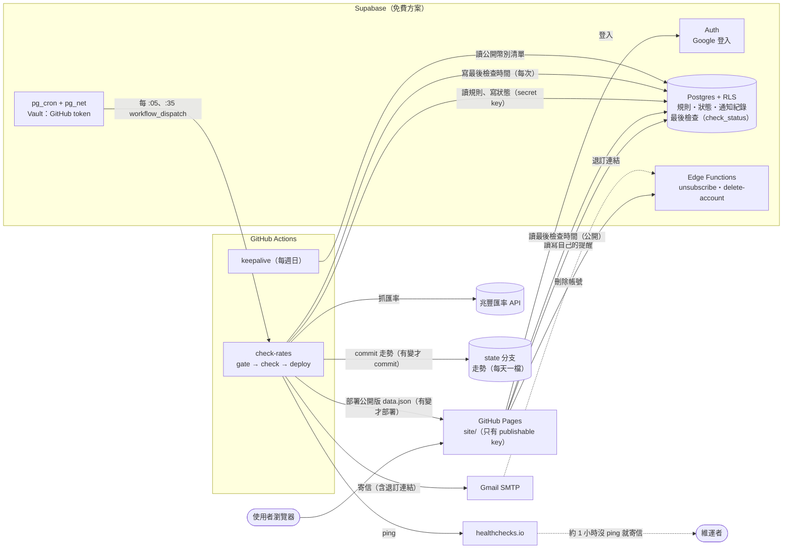

# fx-alert 匯率到價提醒

追蹤兆豐銀行 18 種外幣的**現金賣出價**。用 Google 登入後有兩種提醒：

- **到價提醒**：設定自己的目標價，跌到目標時寄 Email；同一次到價只通知一次。
- **出國換匯計畫**：輸入出發日和需要的外幣金額，依「近 30 天的價格」和「距離出發的天數」寄提醒，
  可以記錄已經換了多少，剩下的繼續追蹤。
全部跑在免費方案上：GitHub Actions、GitHub Pages、Supabase、Gmail、healthchecks.io。

**網站：<https://xysmr.github.io/fx-alert/>**（不登入也能看目前匯率、換匯試算和 30 天走勢）

- [使用者說明](#使用者說明)：登入、設定目標價、出國換匯計畫、取消通知、刪除帳號
- [維運說明](#維運說明)：架構、設定、排程與監控、排查、本機開發

---

# 使用者說明

## 設定提醒

1. 打開網站，按右上角 **用 Google 登入**。
2. 在上方選一個幣別（18 種都可以），按卡片上的 **為○○設定提醒**，輸入 **你的目標**（現金賣出價），按 **新增**。
   - 例如日圓目標 `0.2050`：兆豐的日圓現金賣出價 ≤ 0.2050 時寄信給你。
   - 牌告只到小數第 4 位，目標價也是。越南盾、印尼盾每跳一格（0.0001）就差好幾 %，畫面上會提醒。
   - 目標價和現價差超過 30% 時，儲存前會再問一次，避免打錯小數點。
3. 每天 24 小時（含週末），每 30 分鐘檢查一次（台灣時間 :05、:35）。到價時寄到你登入用的 Gmail（只在你的通知時段內寄，見第 4 點）。
   - 到價判斷看的是檢查當下的價格：匯率如果在兩次檢查之間短暫跌到目標又回升，不會通知。
4. **通知時段（台灣時間）**：在「設定提醒」選開始和結束時間，按 **儲存時段**。預設 08:00–22:00。
   - 只在這段時間內寄信（含開始、不含結束）。開始比結束晚 = 跨午夜（例如 22:00–隔天 07:00）；兩個一樣 = 全天。
   - 到價時如果不在時段內：不寄信、提醒維持「等待中」。時段開始後的第一次檢查會再判斷一次，
     那時還在目標以下才寄；已經回升就繼續等待，**不會補寄**。

登入後，頁面最上面的 **我的提醒** 會列出你所有的提醒：已到價的排前面，其餘依距離目標由近到遠，點一列就切換到那個幣別。

每個幣別一條提醒。可以隨時修改目標價、取消勾選 **啟用** 暫停某個幣別，或按 **刪除** 拿掉。

## 什麼時候會收到信

| 你的提醒狀態 | 什麼時候 | 結果 |
|---|---|---|
| 等待中 | 現價 ≤ 你的目標 | **寄一封信** → 變成「已通知」 |
| 已通知 | 現價還在目標附近或以下 | 不重複寄 |
| 已通知 | 匯率回升超過「進階設定」裡的門檻 | 回到等待中（不寄信），之後再跌到目標會再通知 |
| 已通知 | 你改了目標價，而且現價高於新目標 | 回到等待中（不寄信），跌到新目標會再通知 |

**進階設定**：展開後會顯示「匯率回升到 X 以上，才會再提醒你」。預設是目標價再加 0.5%，
避免匯率在目標附近來回跳時一直收到信。一般不需要調整。

兆豐牌告每個幣別都只到**小數第 4 位**，所以目標價最多 4 位小數，回升門檻至少 0.0001（一個報價單位）。
越南盾、印尼盾這類匯率很小的幣別，每跳一檔就是 5～7%（例如越南盾 0.0015 → 0.0016），
目標價只能在少數幾個值之間選。

重新啟用某個提醒、或重新打開 Email 通知時，提醒會重設為「等待中」，不會補寄關閉期間的通知；
如果當下已經低於目標，下一次檢查就會寄信。

## 出國換匯計畫

不知道目標價該設多少、又有確定的出發日時用。登入後在 **出國換匯計畫** 區塊：

1. 按 **＋ 新增旅程**：選幣別、出發日（明天到一年內）、需要的外幣金額，名稱可以不填。
   選好出發日後，下面會列出這趟旅程會在哪幾天寄信；當天就會寄的標「今天」，已經過了的標「已過，不會寄」。
2. 換了之後，在那趟旅程按 **記錄**，填這次換了多少（匯率可以不填）。剩下的金額繼續追蹤，**全部換完就不再寄提醒**。
3. 旅程頁會顯示：已換多少、還剩多少、現在的價格在近 30 天是第幾低、剩下的金額以現在的價格約需多少台幣、之後哪幾天會寄信。

**什麼時候會收到信**（只在銀行營業日、你的通知時段內寄，一天最多一封）：

| 時候 | 寄什麼 |
|---|---|
| 距離出發 3 週以上 | 現在的價格在近 30 天的**前 20% 低**時寄（7 天最多 1 封） |
| 出發前約 3 週（第一天） | 「可以考慮分批換」1 封，不看價格 |
| 出發前 3 週～1 週 | 現在的價格在近 30 天的**前 40% 低**時寄（5 天最多 1 封） |
| 出發前約 1 週 | 「最後換匯提醒」1 封，不看價格 |
| 出發前倒數第 2 個營業日 | 「出發前提醒」1 封，不看價格；最後 1 個營業日留著備用 |

- 遇到週末或連假，固定日期的提醒會**提早**到前一個營業日，不會延後。
- 信裡會寫原因，例如「現在的價格是近 30 天第 3 低」「距離出發還有 58 天」，以及之後哪幾天會再寄。
- 在提醒日當天建立旅程，當天的提醒還是會寄；提醒日已經過了才建立，那封就不會寄。
- 每人最多 5 趟還沒出發的旅程。出發日和幣別建立後不能改（提醒日期是從出發日算的），要改請刪除後重新建立。
- 原本的到價提醒照常運作，兩種可以同時用。

**這不是投資建議**：信件和網頁只寫事實（第幾低、還有幾天、哪天寄信），不預估匯率會漲或跌，也不建議什麼時候該換。
僅供參考，不保證未來匯率走勢；實際匯率以兆豐銀行公告為準。

## 不想收信、或想刪除帳號

- **暫停所有通知**：取消勾選 **Email 到價通知**，設定會保留，之後可以再打開。
- **一鍵取消**：每封信（到價通知和換匯計畫）都有「取消訂閱」連結，打開後按確認就不會再寄，兩種信都會停（效果同上）。
- **刪除帳號**：在 **帳號** → **刪除我的帳號**，輸入確認文字後刪除。Email、提醒設定、通知紀錄、旅程和換匯紀錄會立刻一起刪除，無法復原。
  為了安全，需要是 10 分鐘內登入的；太久的話請先登出再登入。

## 隱私

只存你的 Email、通知時段、提醒設定、旅程（幣別、出發日、外幣金額、名稱、換匯紀錄）和寄過的信的紀錄；
每個人只看得到自己的資料。
公開的網頁和程式碼都不會出現你的 Email 或目標價。詳見網站上的[隱私說明](https://xysmr.github.io/fx-alert/privacy.html)。

網站上的匯率僅供參考，實際以兆豐銀行公告為準。

---

# 維運說明

## 架構



### 排程與觸發

| 什麼 | 時間（台灣） | 說明 |
|---|---|---|
| **Supabase pg_cron**（主要） | 每天 24 小時，每 :05、:35 | `private.dispatch_check_rates()` 經 pg_net 呼叫 GitHub API，觸發 `check-rates`（`source=pg_cron`、`force=false`） |
| GitHub `schedule`（備援） | 每天 24 小時，每 :07、:37 | GitHub 的排程常延遲或被丟掉，所以只當備援 |
| `check-rates` 的 **gate** | 每次開始時 | 自動觸發且 20 分鐘內已成功檢查過 → 略過（不檢查、不 ping、不部署，仍是綠燈）；手動執行一律檢查。上次檢查的時間讀 Supabase 的 `check_status`，讀不到才用 `state` 分支的 `last_check.json` |
| 檢查時段 | 每天 00:00–23:59 | `config.yaml` 的 `business_hours`；半夜要不要寄信由每個人的通知時段決定 |
| **healthchecks.io** | — | 每次真的檢查成功就 ping；約 1 小時沒收到 → 寄信給維運者 |
| `keepalive` | 每週日 12:23 | 用 publishable key 讀一次公開幣別清單，避免 Supabase 免費專案因閒置暫停 |

pg_cron 的排程寫在 `supabase/migrations/20261116153000_dispatch_24h.sql`（`5,35 * * * *`；UTC 和台灣的分鐘數一樣）。
2026-11-16 以前是平日 09:05–16:05（`20261110020000_dispatch_check_rates.sql`）。

### Workflows（`.github/workflows/`）

| Workflow | 觸發 | 做什麼 |
|---|---|---|
| `check-rates` | pg_cron、GitHub schedule、手動 | gate（去重）→ check（抓匯率、判斷、寄信、寫回狀態、寫 `check_status`、ping 監控）→ 資料有變才 commit 走勢和 deploy（見下方〈什麼時候 commit、部署〉） |
| `deploy-pages` | push 前端／設定到 main、被 check-rates 呼叫、手動 | 產生 `config.js`、`data.json`（`AUTH_ENABLED=true` 時是不含個人設定的公開版）→ 防外洩檢查 → 部署（GitHub 暫時讀不到剛上傳的檔案時，等 30 秒、90 秒自動重試，最多 3 次） |
| `ci` | push、PR | validate-config＋防外洩、ruff、pytest、前端測試、Deno（Edge Functions）、資料庫 RLS 測試（真正的 Supabase） |
| `staging-check` | 手動、staging 的 pg_cron | 用 staging 的 Supabase 跑一次（預設只讀；勾 `send` 才真的寄信） |
| `keepalive` | 每週日、手動 | 讀一次公開幣別清單 |
| `deploy-migrations` | push 到 main 且 `supabase/migrations/**` 或 `supabase/prechecks/**` 有變更、手動（改前端、文件不會觸發） | 先套用到 **staging**（不需核准）→ **staging 成功才**輪到正式專案（**需要核准**，Environment `production`）；手動可選只跑 staging（可選 PR 分支），見〈[資料庫變更](#資料庫變更)〉 |

## 設定一覽

repo 是公開的：**有權限的金鑰只放 Secrets、Edge Function Secrets、Vault**；Variables 只能放公開值（會出現在網頁裡）。

### GitHub Environment `production-runtime`（Settings → Environments）

排程（`check-rates` 的 check job）用的正式金鑰。**放在 Environment，不放 repository secrets**：
個人 repo 的協作者一律有寫入權限，推自己的 branch、改 workflow 就能讀到 repository secrets；
Environment 限定 `main` 之後，只有合併進 main 的 workflow 拿得到。

| 設定 | 內容 |
|---|---|
| Required reviewers | 不設（排程每 30 分鐘自動跑） |
| Deployment branches and tags | Selected branches → `main` |

| Environment secret | 內容 |
|---|---|
| `SUPABASE_URL` | 正式專案網址 `https://<專案代號>.supabase.co` |
| `SUPABASE_SECRET_KEY` | 正式專案給 GitHub 用的 secret key（`sb_secret_…`） |
| `UNSUBSCRIBE_SECRET` | 退訂連結的簽章密鑰（≥ 32 字元），**必須和正式專案 Edge Function 的同名 secret 相同** |
| `SMTP_USER` | 寄件 Gmail 帳號 |
| `SMTP_PASSWORD` | Gmail **應用程式密碼**（帳號需開啟兩步驟驗證） |
| `HEALTHCHECK_PING_URL` | （選用）healthchecks.io 的 ping 網址；等同密碼 |

### GitHub Environment `staging-runtime`（Settings → Environments）

`staging-check` 用。設定同上（不設審核者、只允許 `main`），所以 `staging-check` 只能選 main 執行。

| Environment secret | 內容 |
|---|---|
| `STAGING_SUPABASE_URL`、`STAGING_SUPABASE_SECRET_KEY`、`STAGING_UNSUBSCRIBE_SECRET` | staging 專案 |
| `SMTP_USER`、`SMTP_PASSWORD` | 和 `production-runtime` 相同 |

**Repository secrets（Settings → Secrets and variables → Actions）應該是空的。**
`tests/test_workflows.py` 檢查：用到 secrets 的 job 一定綁 Environment。

### GitHub Environment `staging`（Settings → Environments）

| 項目 | 設定 |
|---|---|
| Required reviewers | 不設（staging 是測試環境，`deploy-migrations` 的 staging job 直接執行） |
| Environment secret `STAGING_DB_URL` | staging 資料庫的 **Session pooler** 連線字串（含資料庫密碼），取得方式和下面的 `PRODUCTION_DB_URL` 一樣（換成 staging 專案）。**不要**叫 `SUPABASE_DB_URL`，也不要設成一般的 repository secret |

### GitHub Environment `production`（Settings → Environments）

| 設定 | 內容 |
|---|---|
| Required reviewers | 自己（`XYSMR`）：`deploy-migrations` 要按核准才會執行 |
| Deployment branches and tags | Selected branches → `main` |
| Environment secret `PRODUCTION_DB_URL` | 正式專案資料庫的 **Session pooler** 連線字串（含資料庫密碼）。只有核准後的 `deploy-migrations` 拿得到；**不要**設成一般的 repository secret，也不要叫 `SUPABASE_DB_URL`（那是 `tests/db` 用的名稱，測試會清空資料表） |

### GitHub Variables（同一頁的 Variables 分頁）

| Variable | 內容 |
|---|---|
| `SUPABASE_URL` | 正式專案網址（前端用） |
| `SUPABASE_PUBLISHABLE_KEY` | `sb_publishable_…`（公開金鑰，安全靠 RLS） |
| `AUTH_ENABLED` | `true`：網站顯示登入、`data.json` 用公開版。刪掉這個 Variable＝回到單人版的網站 |
| `WEB_PUSH_PUBLIC_KEY` | 手機推播的 VAPID **公鑰**（87 字、`B` 開頭，公開的）。沒設定時推播區塊顯示「還在設定中」。產生方式見 `docs/web-push.md` |

### Supabase（正式、staging 各自設定）

| 位置 | 名稱 | 內容 |
|---|---|---|
| Edge Functions → Secrets | `UNSUBSCRIBE_SECRET` | 和 GitHub Secret 相同的值（名稱手動輸入，**結尾不能有空白**） |
| Edge Functions → Secrets | `FX_SECRET_KEY` | 給 Edge Function 用的另一把 secret key |
| Integrations → Vault | `github_dispatch_token` | fine-grained PAT：只限 fx-alert、只開 **Actions: Read and write**、90 天到期；正式、staging 各一把 |
| Integrations → Vault | `github_dispatch_workflow` | 正式專案 `check-rates.yml`；staging `staging-check.yml` |
| Authentication → URL Configuration | Site URL、Redirect URLs | 正式專案只有 `https://xysmr.github.io/fx-alert/`（**不放 localhost**，本機開發一律對 staging） |
| Authentication → Providers | Google | Client ID／Secret 來自 Google Cloud 的 OAuth 用戶端；Email 登入關閉 |

Vault 一律在後台頁面新增，**不要**用 SQL Editor 執行 `vault.create_secret(...)`（查詢紀錄會留下 token）。

### 其他

- **GitHub Pages**（Settings → Pages）：Source 選 **GitHub Actions**。
- **healthchecks.io**：見下方〈[監控](#監控healthchecksio)〉。
- `config.yaml`：見下一節。

### 支援的幣別

兆豐牌告上**有現金賣出價**的 18 種：美元 USD、港幣 HKD、英鎊 GBP、日圓 JPY、澳幣 AUD、加拿大幣 CAD、
新加坡幣 SGD、瑞士法郎 CHF、泰銖 THB、紐西蘭幣 NZD、歐元 EUR、韓元 KRW、馬來西亞幣 MYR、印尼盾 IDR、
菲律賓比索 PHP、澳門幣 MOP、越南盾 VND、人民幣 CNY。南非幣 ZAR、瑞典幣 SEK 兆豐只有即期匯率，不支援。

清單只寫在 [`src/fx_alert/currencies.py`](src/fx_alert/currencies.py)；資料庫的 `currencies` 表由 migration 寫入相同內容，
測試會比對兩邊一致。多人版每次檢查都記錄這 18 種的走勢：

- 沒有人設定提醒的幣別缺報價：log 只記一行「注意」，不算失敗。

### 公開 log 的原則

repo 是公開的，GitHub Actions 的 log 任何人都看得到。所以 log 裡：

- **只寫編號**：「規則#7」「旅程#12」，連幣別都不寫（幣別加上公開的匯率，可以推出目標價的範圍）
- **不寫**：email、user_id、目標價、buffer、通知時段、外幣金額、出發日、距離出發的天數、信件主旨（主旨含目標價）
- 可以寫：狀態（armed → triggered）、提醒種類、牌告時間、幣別數量、錯誤類型
- CLI 印出的每一行再經過 `redact_emails`（萬一錯誤訊息帶了 email）
- `config.yaml` 驗證只列幣別，不印目標價
- `tests/test_log_privacy.py`：走真正的 `check --mode multi`（含 dry-run、寄信失敗、通知時段外、換匯提醒），資料裡放容易辨認的目標價、email、金額、日期，檢查輸出裡都找不到
- 有人設定提醒的幣別缺報價：算失敗（可能漏通知），healthchecks.io 會通知。
- 牌告出現清單裡沒有的新幣別：log 提醒更新 `currencies.py`。

### `config.yaml`

| 欄位 | 多人版怎麼用 |
|---|---|
| `currencies` 的幣別清單 | 網站公開顯示哪些幣別的行情（走勢則是全部 18 種都會記錄，見下方〈支援的幣別〉） |
| `currencies` 的 `target`、`buffer` | **不會用到**。只在退回單人版、執行 `migrate-me` 時使用；**使用者的目標價在網站上設定**（`export-state` 也會拿來比對，網站上改過的目標價只會提醒、不會寫回） |
| `business_hours` | 檢查時段（台灣時間）：目前 00:00–23:59、每天（`weekdays_only: false`） |
| `email.daily_limit` | 每天最多寄幾封到價通知（Gmail 個人帳號約 500 位收件人／天，預設 400） |
| `data_dir` | `state` 分支在 Actions 上的資料夾 |

改了 `config.yaml` 會觸發 CI（格式驗證）和重新部署網站；格式錯誤時排程不會檢查、網站也不會部署。

### 金鑰到期

| 金鑰 | 放在哪裡 | 到期日 |
|---|---|---|
| `fx-alert-dispatch-prod`（GitHub fine-grained PAT） | 正式專案 Vault `github_dispatch_token` | **2027-02-08** |
| `fx-alert-dispatch-staging`（GitHub fine-grained PAT） | staging Vault `github_dispatch_token` | **2027-02-08** |
| Supabase secret key（`github_actions_nov26`、`edge_functions_2`） | GitHub Environment `production-runtime` 的 `SUPABASE_SECRET_KEY`、Edge Function Secret `FX_SECRET_KEY` | 不會到期 |
| `UNSUBSCRIBE_SECRET` | GitHub Secret＋Edge Function Secret（同一個值） | 不會到期 |

更換步驟見〈[定期維護](#定期維護)〉。

### 什麼時候 commit、部署

每次檢查都會把結果（時間、成功與否、錯誤數量）寫到 Supabase 的 `check_status`，網頁頂端的狀態列直接讀它。
所以 `state` 分支和 GitHub Pages 只在需要時才更新（`src/fx_alert/publish.py`）：

| 這次檢查 | commit `state` 分支 | 部署網頁 |
|---|---|---|
| 記到新的牌告（走勢有變）、或走勢檔案格式轉換 | ✓ | ✓ |
| 成功 ↔ 失敗（壞掉、恢復） | ✓ | ✓ |
| 只有最後檢查時間改變（牌告沒更新） | — | — |

**Supabase 讀不到時（例如專案被暫停）**：公開頁面照常顯示，狀態列改用 `data.json` 的產生時間（不會顯示錯誤或留白）；
gate 改用 `state` 分支的 `last_check.json`（可能比較舊 → 照常檢查）。

## 資料存放

| 位置 | 內容 | 公開？ |
|---|---|---|
| Supabase `profiles` | 每人的 Email、Email 通知開關、通知時段（台灣時間） | 否（RLS：只看得到自己） |
| Supabase `alert_rules` | 每人每幣別的目標價、buffer、狀態 | 否 |
| Supabase `notifications` | 通知紀錄 | 否 |
| Supabase `trips` | 出國換匯計畫的旅程：幣別、出發日、需要的外幣金額、名稱（每人最多 5 趟還沒出發的；出發日、幣別建立後不能改） | 否 |
| Supabase `trip_exchanges` | 使用者自己記錄的「已經換了多少」（每趟最多 50 筆） | 否 |
| Supabase `trip_notifications` | 換匯計畫寄過的提醒（種類、日期、當時價格和近 30 天第幾低）；一天最多一封、固定提醒每趟一次，資料庫會擋 | 否 |
| Supabase `check_status` | 最後一次檢查的時間、是否成功、錯誤**數量**（只有一列；網頁狀態列、gate 讀它） | 是（任何人可讀，只有 secret key 能寫） |
| `state` 分支 `history/YYYY-MM-DD.csv` | 匯率走勢（`quoted_at,currency,cash_sell`），每天一檔（台灣日期）。舊的每月一檔（`YYYY-MM.csv`）照樣讀得到，下一次檢查時會自動拆成每天一檔 | 是 |
| `state` 分支 `last_check.json` | 和 `check_status` 一樣的內容，但只在資料有變時才 commit（Supabase 讀不到時的備援） | 是 |
| `state` 分支 `state.json`、`alerts.csv` | 單人版時期的狀態與通知紀錄；多人版不再更新，只在退回單人版時使用 | 是 |
| repo `seed/mega_daily_close.csv` | 兆豐官方的每日收盤價（現金賣出），2025-11-17～2026-11-16，一次性回補（見〈資料來源〉） | 是 |
| 網站 `data.json` | 公開行情（不含任何人的目標價、狀態、通知紀錄）；每個幣別的 `recent` = 近 30 天營業日收盤價裡有幾天比現價低 | 是 |

commit 到 `state` 分支、部署 `data.json` 前都會自動掃描，確認沒有 Email 或個人設定。

## 定期維護

### 每年約 6 月：補上隔年的營業日曆（目前到 **2027-12-31**）

出國換匯計畫用 `seed/tw_bank_calendar.csv` 判斷銀行營業日。人事行政總處每年約 6 月公布隔年的
「政府行政機關辦公日曆表」（[data.gov.tw 資料集 14718](https://data.gov.tw/dataset/14718)）。公布後：
1. 下載隔年的 CSV，把週一到週五「是否放假=2」的日子加成 `off`、週末「是否放假=0」的日子加成 `workday`
2. 改 `src/fx_alert/bizdays.py` 的 `COVERED_UNTIL`，`seed/README.md` 記下檔案和 SHA-256
3. `python scripts/make_trip_fixture.py` 重新產生 Python／網頁對照用的檔案，把 `FIRST`、`LAST` 往後延
4. `pytest`、`node --test site/tests/*.test.js` 都通過再開 PR

沒有補的話：出發日超過涵蓋範圍的旅程只用「週一到週五」判斷營業日，排程的 log 會提醒更新。
詳細見 [docs/trip-plan.md](docs/trip-plan.md#維護)。

### 颱風停班之後：補進營業日曆

臺北市宣布停止上班時，外匯市場休市、兆豐沒有 16:00 牌告，但辦公日曆表上還是上班日。
事後確認兆豐那天沒有收盤價，在 `seed/tw_bank_calendar.csv` 加一行 `日期,off,颱風停班（臺北市；外匯市場休市）`。
未來的颱風沒辦法預先知道：如果出發前提醒那天剛好停班，會在下一個營業日（備用日）補寄。

### 進行中：網站做成 PWA、手機推播通知

設計和決定都在 [`docs/web-push.md`](docs/web-push.md)。目前完成 PR 1：網站可以「加到主畫面」（manifest、圖示、`sw.js`），
PR 2 資料表、PR 3 設定頁的訂閱介面；寄送（PR 4）還沒做。正式專案的推播等 12/15 A10 Demo 之後才開放。

修改 `site/sw.js` 時，請把裡面的 `SW_VERSION` 改成新的日期；使用者手機怎麼更新到新版，見 `docs/web-push.md`。

### 不做的事

- **不用 LLM 推薦目標價**：和「不提供投資建議」的原則衝突，結果也難以測試。目標價由使用者自己設定；
  出國換匯計畫只陳述事實（現價、近 30 天第幾低、距出發幾天），用語中性並註明「僅供參考，不保證未來匯率走勢」。

### 待辦：評估週末要不要檢查（**2026-11-30 之後**）

24 小時檢查從 2026-11-16 開始，包含週末。跑滿兩個週末後，用 `state` 分支的 `history/` 統計
**週末（週六 06:00 到週一 08:00，台灣時間）** 牌告變動了幾次。兩個週末都是 0 次，再評估要不要改成只跑平日
（改 `config.yaml` 的 `weekdays_only`、pg_cron 和 GitHub 的排程、healthchecks.io 的 Schedule）。

```bash
git fetch origin state && git worktree add /tmp/fx-state origin/state
python - <<'PY'
import csv, glob
from datetime import datetime
for name in sorted(glob.glob("/tmp/fx-state/history/*.csv")):
    times = sorted({r["quoted_at"] for r in csv.DictReader(open(name, encoding="utf-8"))})
    weekend = [t for t in times
               if (d := datetime.fromisoformat(t)).weekday() == 5 and d.hour >= 6
               or d.weekday() == 6 or d.weekday() == 0 and d.hour < 8]
    if weekend:
        print(name.rsplit("/", 1)[1], "週末牌告", len(weekend), "份")
PY
```
每一份牌告（`quoted_at`）就是一次變動；沒有印出任何一行 = 週末完全沒有變動。

### 每年兩次左右：更換 pg_cron 用的 GitHub token（下次 **2027-02-08** 到期）

**在 2027-02-01 前後（到期前一週）**換掉，正式、staging 各一把，步驟相同。token 過期時 pg_net 會回 401，
只剩常延遲的 GitHub schedule 備援，healthchecks.io 會寄 DOWN 通知。

1. 到 <https://github.com/settings/personal-access-tokens/new> 建立新的 fine-grained token：
   - 名稱：`fx-alert-dispatch-prod`（staging 用 `fx-alert-dispatch-staging`）
   - Expiration：**90 days**（記下新的到期日）
   - Repository access：**Only select repositories → fx-alert**
   - Permissions：只開 **Actions: Read and write**
2. 該專案的 Supabase 後台 → **Integrations → Vault**，編輯 `github_dispatch_token`，貼上新 token 後儲存。
   不要用 SQL Editor（查詢紀錄會留下 token）。
3. 等下一個 :05 或 :35，在該專案的 SQL Editor 確認回 **204**：
   ```sql
   select to_char(created at time zone 'Asia/Taipei', 'MM-DD HH24:MI:SS') as 時間,
          status_code, left(coalesce(error_msg, content::text, ''), 200) as 內容
   from net._http_response order by created desc limit 3;
   ```
   正式專案再到 Actions → `check-rates`，確認同一分鐘有一筆 `workflow_dispatch`（source: pg_cron）。
4. 確認 204 之後，回到 <https://github.com/settings/personal-access-tokens> **刪除舊的 token**。
5. 更新這份 README〈[金鑰到期](#金鑰到期)〉表格裡的到期日。

### 需要時：更換正式專案的 Supabase secret key

secret key 不會到期，但只要曾經出現在畫面、剪貼簿、聊天紀錄或 log，就要換。
GitHub 和 Edge Function **用的是兩把不同的 key**，兩把都要換；**先建新的、兩邊都更新、測試通過，最後才刪舊的**，
過程中服務不會中斷。

1. **建立新 key**：正式專案 → Project Settings → **API Keys** → Secret keys → **Add new secret key**，
   建立兩把，例如 `github_actions_3`、`edge_functions_3`（舊的先不要刪）。
2. **更新 GitHub**：Settings → Environments → `production-runtime` → `SUPABASE_SECRET_KEY` → 編輯 → 貼上 `github_actions_3`。
3. **更新 Edge Function**：正式專案 → Edge Functions → **Secrets** → Name 手動輸入 `FX_SECRET_KEY`（結尾不能有空白）
   → 貼上 `edge_functions_3` → Save（出現「Replace secret」就確認）。
4. **測試新 key**：
   - Actions → `check-rates` → Run workflow，勾 **dry_run**（不寄信、不寫入）：log 要讀到每條規則（例如「規則#1: armed → armed：尚未到價」），
     沒有出現 Supabase 401。
   - Edge Functions 的冒煙測試（步驟見 [`docs/multi-user.md`](docs/multi-user.md)「冒煙測試」）：
     兩支 function 用 GET 回 405、delete-account 沒帶 token 回 401、退訂錯誤簽章回 403；
     用 `unsubscribe-link` 產生不存在帳號的退訂連結並 POST，回 `{"ok":true,"status":"no_account"}`（這一項會用到 `FX_SECRET_KEY`）。
5. **刪除舊 key**：API Keys 頁面刪除舊的兩把（確認名稱不是新的那兩把）。
6. **再測一次**：重複第 4 步，確認已經沒有任何地方還在用舊 key。

剪貼簿用完記得清空（PowerShell：`Set-Clipboard -Value " "`）。

### 需要時：更換 `UNSUBSCRIBE_SECRET`

GitHub Secret 和正式專案的 Edge Function Secret 要**同時**換成同一個新值（≥ 32 字元，例如
`python -c "import secrets; print(secrets.token_urlsafe(32))"`）。換掉後，**已經寄出的信裡的退訂連結會失效**。
換完跑一次第 4 步的退訂測試（回 `no_account`）。

### 確認 GitHub Secret 和 Edge Function 的 `UNSUBSCRIBE_SECRET` 一致

`python -m fx_alert unsubscribe-check`（需要環境變數 `SUPABASE_URL`、`UNSUBSCRIBE_SECRET`）：
用一個**不存在的帳號**（`00000000-0000-4000-8000-000000000000`）產生退訂連結，POST 給 Edge Function。

| 結果 | 意思 |
|---|---|
| 通過（200 `no_account`） | 兩邊一致；沒有這個帳號，所以什麼都沒改 |
| 簽章不符（403 `invalid_link`） | 兩邊不一致：信裡的退訂連結會失效 |
| 沒有設定（500 `not_configured`） | Edge Function 沒有 `UNSUBSCRIBE_SECRET` 或少於 32 字元 |
| 寫不進資料庫（500 `update_failed`） | 簽章一致，但 Edge Function 的 `FX_SECRET_KEY` 有問題 |

只印結果，不印連結、簽章或密鑰，可以在公開的 Actions log 裡跑。`staging-check` 每次都先跑這一步，
不一致就停下來、不寄信。

**對齊 staging**（`STAGING_UNSUBSCRIBE_SECRET` 和 staging 專案 Edge Function 的 `UNSUBSCRIBE_SECRET`）：
Supabase 後台看不到已設定的值，所以兩邊一起換成同一個新值：
1. 在自己的電腦產生新值（不要貼到任何地方，只複製到下面兩處）：
   `python -c "import secrets; print(secrets.token_urlsafe(48))"`
2. GitHub → repo **Settings → Environments → `staging-runtime`** → `STAGING_UNSUBSCRIBE_SECRET` → 編輯 → 貼上
3. Supabase → **staging 專案** → **Edge Functions → Secrets** → `UNSUBSCRIBE_SECRET` → 改成同一個值（結尾不能有空白）
4. Actions → `staging-check` → Run workflow（不勾 send）→ `Unsubscribe link check` 顯示「通過」

staging 換掉後，舊的 staging 測試信裡的退訂連結會失效（正式專案不受影響）。

## 排程沒有執行時怎麼排查

GitHub Actions 的 `schedule` 是「盡力而為」：官方文件寫明負載高時（尤其整點、UTC 00:00–08:00）會**延遲**，
負載夠高時排隊中的排程會被**直接丟掉**，而且**不會出現在任何紀錄裡，也不會顯示失敗**。
所以主要的觸發改由 Supabase pg_cron 負責，GitHub schedule 當備援，並用 healthchecks.io 發現「沒有執行」。

### 監控：healthchecks.io

每次**真的檢查成功**後，`check-rates` 會 ping 一次；失敗時 ping `/fail`。
略過時（時段外、gate 去重、`dry_run`）都不 ping，監控才能發現該跑的時段沒有檢查。

1. 到 <https://healthchecks.io> 註冊（免費方案可監控 20 個工作），新增一個 check：
   - **Schedule**：選 **Cron**，填
     ```
     7,37 * * * *
     ```
     （2026-11-16 改成 24 小時；以前是 `7,37 9-15 * * 1-5` 和 `7 16 * * 1-5` 兩行）
   - **Time Zone**：`Asia/Taipei`
   - **Grace Time**：`30 minutes`（下一次也沒來，就是約 1 小時沒有 ping → 寄信）
   - **Integrations**：Email
2. 複製 **ping URL**，放到 GitHub Secret `HEALTHCHECK_PING_URL`。⚠ 不要寫進 repo、issue 或截圖。
3. 手動跑一次 `check-rates`，check 應該變成綠色 **up**。沒設定這個 Secret 時只會略過 ping，不會讓排程失敗。

### 收到 DOWN 通知時，照順序檢查

1. **pg_cron 有沒有觸發**：在正式專案的 SQL Editor 執行
   ```sql
   select to_char(d.start_time at time zone 'Asia/Taipei', 'MM-DD HH24:MI') as 時間, d.status, d.return_message
   from cron.job_run_details d join cron.job j using (jobid)
   where j.jobname like 'fx-alert-dispatch%' order by d.start_time desc limit 5;

   select to_char(created at time zone 'Asia/Taipei', 'MM-DD HH24:MI:SS') as 時間,
          status_code, left(coalesce(error_msg, content::text, ''), 200) as 內容
   from net._http_response order by created desc limit 5;   -- 只保留 6 小時
   ```
   | `status_code` | 意思 |
   |---|---|
   | **204** | GitHub 已接受觸發（問題在 GitHub 端，往下看） |
   | 401 | token 錯誤或已過期 → 換新的 PAT（見〈[定期維護](#定期維護)〉） |
   | 403、404 | token 沒選到 fx-alert，或沒開 Actions 寫入 |
   | 422 | 送出的 inputs 和 workflow 對不上（migration 和 workflow 版本不一致） |
   | 空白＋錯誤訊息 | 網路問題或逾時 |

   `cron.job_run_details` 完全沒有新紀錄：Supabase 專案可能被暫停了（到 Supabase 後台恢復）。
2. **workflow 是不是被停用了**：Actions → `check-rates`，出現「This workflow was disabled」就按 **Enable workflow**。
   公開 repo **60 天沒有任何活動**時，GitHub 會自動停用排程。
3. **有沒有執行紀錄**：Actions → `check-rates`。
   - **紅的**：點進去看哪一步失敗。`gate` 的 **Show trigger** 會印出觸發方式、source、實際開始時間。
     常見原因：`Validate config.yaml` 格式錯誤；兆豐 API 或 Supabase 暫時連不上（下一次通常就好了）；Secrets 被改錯（Supabase 回 401）。
   - **綠的但 check 被略過**：看 gate 的 **Decide**，「N 分鐘前已經成功檢查過，略過這次」是正常的去重。
   - **綠的、有 check，但寫「不在檢查時段內」**：觸發得太晚（例如 GitHub 排程延遲好幾小時），屬於正常略過。
4. **補救**：Actions → `check-rates` → **Run workflow**（`force` 保持勾選、`source` 保持 manual）立刻補跑一次。
5. **確認恢復**：healthchecks.io 回到 **up**；正式專案的 `check_status`（Table Editor）時間是最新的。
   `state` 分支只在牌告有更新時才 commit，沒有新 commit 不一定代表沒檢查。

## 本機開發

本機開發一律連 **staging**（正式專案不允許 localhost 登入）。

```powershell
python -m venv .venv
.venv\Scripts\Activate.ps1                 # macOS / Linux: source .venv/bin/activate
python -m pip install -e ".[dev]"

python -m pytest                           # Python 測試
python -m ruff check .                     # lint
node --test site/tests/app.test.js site/tests/account.test.js site/tests/unsubscribe.test.js  # 前端測試
# 資料庫測試（tests/db）需要 Supabase CLI + Docker，沒有的話會自動略過、交給 CI 跑

python -m fx_alert validate-config         # 驗證 config.yaml
python -m fx_alert build-site              # 產生 site/data.json

# 前端連 staging：產生指向 staging 的 site/config.js（只用 publishable key）
$env:AUTH_ENABLED = "true"
$env:SUPABASE_URL = "https://<staging 專案代號>.supabase.co"
$env:SUPABASE_PUBLISHABLE_KEY = "sb_publishable_..."
$env:WEB_PUSH_PUBLIC_KEY = "B..."          # 選填：staging 的推播公鑰（測推播時才需要）
python -m fx_alert site-config --out site\config.js
python -m http.server 8000 -d site         # 開 http://localhost:8000/

# 多人版檢查（只讀不寫）：secret key 只從環境變數讀，不要寫進 .env
# python -m fx_alert check --mode multi --dry-run --force
```

前端也可以用範例資料預覽（範例中的走勢是假資料，用 `python scripts/make_samples.py` 重新產生）：

| 網址參數 | 情境 |
|---|---|
| `?data=samples/waiting.json` | 兩個幣別都在等待中 |
| `?data=samples/triggered.json` | 日圓已低於目標、已寄通知 |
| `?data=samples/rebound.json` | 日圓已通知過，但回升到目標和回升門檻之間 |
| `?data=samples/empty.json` | 還沒有任何資料 |
| `?data=samples/error.json` | 最後一次檢查失敗 |
| `?data=samples/new.json` | 資料從 11/09 才開始累積（不滿 30 天）、間隔不一、只有約 0.3% 的小波動 |
| 加上 `&public=1` | 模擬多人版**沒登入**的公開頁面（拿掉範例裡的目標價） |
| 加上 `&now=2026-11-14T12:00` | 把「現在」設成指定的台灣時間（例如週末，看「非檢查時段」的狀態列） |

> Windows 若出現「應用程式控制原則已封鎖此檔案」，把 `pytest`、`ruff` 改成 `python -m pytest`、`python -m ruff`。

### 資料庫變更

migration 放在 `supabase/migrations/`，檔名 `<14 位數字版本號>_<名稱>.sql`。

1. **PR**：CI 在本機 Supabase 套用全部 migration 並跑 RLS 測試。
2. **staging（合併前）**：Actions → `deploy-migrations` → **Run workflow** → Use workflow from 選 **PR 的分支**、
   target 選 **staging** → 套用後在 staging 驗證。不用再把 SQL 貼進 SQL Editor。
   **PR 最後沒有合併、或合併前又改了 migration**，staging 會和 main 不一致，見〈[staging 多出來的 migration](#staging-多出來的-migration)〉。
3. **合併到 main 後**（`supabase/migrations/**` 或 `supabase/prechecks/**` 有變更才會觸發）：`deploy-migrations` 自動啟動，
   **先套用到 staging**（第 2 步已經套用過的話，這一步什麼都不做）；**staging 成功才會輪到正式專案**，
   正式專案**等你在 Actions 頁面按核准**才執行。staging 失敗時正式專案的 job 直接略過，不會出現核准按鈕。
   手動 **Run workflow** 選 target **production** 也一樣先跑 staging（只能在 main 跑）。

   兩個 job 的步驟相同：
   1. 比對 repo 和資料庫的紀錄（`supabase_migrations.schema_migrations`），算出要補紀錄、要套用哪些版本（只讀）
   2. **事前檢查**（只讀；任何一項沒通過就停止，什麼都不寫）
      - 要補紀錄的版本：`supabase/baseline_checks/<版本號>_*.sql` 確認那個 migration 建立的物件真的存在
        （例如 pg_cron 的 dispatch 函式、`fx-alert-dispatch` 兩個 cron job）；物件不存在、查詢出錯、或沒有檢查檔都會停止，
        避免「其實沒套用、卻被標成已套用」
      - 待套用的版本：`supabase/prechecks/<版本號>_*.sql` 回傳任何一列就停止（log 只印列數，不印內容）
   3. **唯一會寫入的一步**：再確認計畫和第 1 步相同、在同一個連線上再跑一次第 2 步的檢查，然後
      - 補上以前手動套用、但沒有紀錄的版本（正式專案 `supabase/migrations_baseline.txt`、
        staging `supabase/migrations_baseline_staging.txt`；只寫紀錄，不重新執行）
      - 依序套用，每個 migration 一個交易（SQL 和紀錄一起 commit；失敗就整個 rollback，不會只套用一半）
   4. 再比對一次，確認沒有遺漏

   寫入用 Python（psycopg），不用 Supabase CLI：`supabase@3.0.0` 的 `--remote` 解析不了 Session pooler 的連線字串
   （第一次執行時 `failed to parse connection string`），psycopg 則可以正常連線。紀錄寫在 CLI 用的同一張表、
   同樣的欄位（`version`、`name`、`statements`），`supabase migration list` 照樣看得懂。

**核准前先想一下時機**：有依賴 workflow 或前端的 migration（例如 pg_cron 送出的 inputs），
要等相關的程式也合併、部署好再核准；反過來，程式要用到新欄位的，先核准 migration 再合併程式。
可以先不核准，等時機對了再到 Actions → `deploy-migrations` 那一次執行按 **Review deployments → Approve**；
也可以按 Reject，之後用 **Run workflow** 手動重跑。

**加了新限制的 migration**（check constraint、not null 等），請一起寫事前檢查
`supabase/prechecks/<版本號>_<名稱>.sql`：一段 select，列出「不符合新限制」的資料（應該回傳 0 列）。
事前檢查失敗時，到 SQL Editor 執行同一段 SQL 找出資料、修正後重跑。

`migrations_baseline.txt` 只記錄自動部署開始前手動套用的 7 個版本，**之後的 migration 不要加進去**；
`migrations_baseline_staging.txt` 同理（staging 2026-11-17 時沒有紀錄的 7 個版本）。
兩份清單的每個版本都要有一個 `supabase/baseline_checks/` 物件檢查（每列回傳 `item`、`ok`；兩邊共用），測試會確認。

#### staging 多出來的 migration

用 PR 分支套用到 staging 之後，有兩種情況會讓 staging 和 main 不一致：

| 情況 | 怎麼發現 | 會怎樣 |
|---|---|---|
| **PR 沒有合併**（關掉了） | 之後每次 staging job 第 1 步都會出現**警告**「staging 有 main 沒有的 migration（還沒合併的 PR？）：<版本>」，Actions 的執行摘要也會列出 | 只警告，不擋其他部署（PR 還開著時本來就會這樣）。但 staging 多了 main 沒有的表或欄位，之後的測試可能不準 |
| **PR 套用到 staging 之後又改了 migration，再合併** | 合併後 staging job 第 1 步**失敗**：「staging 紀錄裡的內容和 repo 不同：<版本>」（比對紀錄裡存的 SQL 和 repo 的檔案） | staging 失敗，**正式專案不會執行**，直到清理完 |

手動檢查（任何時候）：Actions → `deploy-migrations` → Run workflow → target **staging**、分支 **main**，
看第 1 步有沒有上面兩種訊息；沒有要套用的東西時，什麼都不會寫入。

**清理**（都在 staging 的 SQL Editor，每一步先確認再執行）：
1. 寫一段**還原 SQL**，把那個 migration 建立的東西拿掉（`drop table / drop column / drop function / cron.unschedule …`），
   改過的東西改回 main 的樣子。不確定的話，先看那個 PR 的 migration 內容，一項一項對應。
2. 刪掉那一筆紀錄：`delete from supabase_migrations.schema_migrations where version = '<版本>';`
3. 重跑 `deploy-migrations`：
   - PR **沒合併**：target staging、分支 main，確認警告不見了
   - PR **改過再合併**：target staging、分支 main，會用 main 的新版內容重新套用；成功後再跑 target production（或重跑那次失敗的 workflow）

建議：PR 關掉不合併時，**當下就清理** staging；同一時間盡量只有一個「已套用到 staging、還沒合併」的 migration PR。

**第一次設定**（只做一次）：

1. Settings → Environments → **New environment** → 名稱 `production`
   - **Required reviewers**：勾選、加入自己
   - **Deployment branches and tags**：Selected branches and tags → 加入 `main`
2. 取得連線字串：Supabase 正式專案 → 上方 **Connect** → **Connection string** →
   Type 選 **URI**、Method 選 **Session pooler**，複製
   `postgresql://postgres.<專案代號>:[YOUR-PASSWORD]@aws-…pooler.supabase.com:5432/postgres`
   - 用 **Session pooler**（port 5432）：GitHub Actions 的機器只有 IPv4，Direct connection 在免費方案只有 IPv6；
     Transaction pooler（port 6543）不適合跑 migration
   - `[YOUR-PASSWORD]` 換成資料庫密碼。忘記的話：Project Settings → Database → **Reset database password**
     （這個專案只有部署 migration 會用到資料庫密碼，重設不影響排程和網站）。
     建議只用英數字，否則特殊字元要做 URL 編碼
3. 在 `production` environment 新增 **Environment secret** `PRODUCTION_DB_URL`，貼上第 2 步的完整字串
4. Actions → `deploy-migrations` → **Run workflow** → 核准 → log 應顯示要補紀錄的版本，最後「確認完成」

**staging 第一次設定**（只做一次）：

1. Settings → Environments → **New environment** → 名稱 `staging`（不設 Required reviewers）
2. 取得 staging 專案的 Session pooler 連線字串（同上面第 2 步，換成 staging 專案）
3. 在 `staging` environment 新增 **Environment secret** `STAGING_DB_URL`
4. Actions → `deploy-migrations` → **Run workflow** → 分支 `main`、target **staging**：
   第 1 步應顯示**補紀錄 7 個版本**（`migrations_baseline_staging.txt`）、沒有要套用的；
   第 2 步 7 個版本都「物件都存在，可以補紀錄」；最後「確認完成（staging）」

## 退回單人版

步驟見 [`docs/multi-user.md`](docs/multi-user.md) 的「D. 退回方案」：停用排程、刪掉 Variable `AUTH_ENABLED`、
用 `python -m fx_alert export-state` 把資料庫裡的狀態寫回 `state` 分支、把 `check-rates` 改回單人模式。

走勢檔案（每天一檔）單人版、多人版共用同一份程式，退回時不需要轉換；`export-state` 只寫 `state.json` 和 `alerts.csv`。

## 專案結構

```
src/fx_alert/
  fetcher.py      下載兆豐匯率 JSON
  parser.py       解析成 Decimal（缺值 = None）
  rules.py        到價狀態機（純函式）
  store.py        規則與狀態的存放處：SupabaseStore（多人版）／FileStore（單人版）
  gate.py         check-rates 的去重判斷（只用標準函式庫）
  notifier.py     Gmail SMTP / dry-run
  unsubscribe.py  一鍵退訂的 HMAC 簽章與連結
  history.py      走勢、通知紀錄、最後檢查
  config.py       讀取並驗證 config.yaml、檢查時段
  build_site.py   產生前端用的 data.json（--public：多人版的公開版）
  site_config.py  產生 site/config.js（只放 publishable key）
  migrate.py      單人版 → 多人版的搬家工具（migrate-me）
  export_state.py 多人版 → 單人版的反向匯出（export-state，退回用）
  state_store.py  單人版的 state.json
  daily.py        每日收盤價（seed + 自己記錄的牌告）、近 30 天第幾低
  bizdays.py      銀行營業日（seed/tw_bank_calendar.csv）
  trip_rules.py   出國換匯計畫的提醒規則（純函式）
  trip_mail.py    出國換匯計畫的提醒信
  paths.py        找 repo 裡的 seed/（pip install 之後也找得到）
  notify_window.py 通知時段
  main.py         CLI：check / build-site / site-config / validate-config / unsubscribe-check / migrate-me / export-state …
site/
  index.html  style.css  app.js     網站（純 HTML/JS，無建置步驟）
  account.js                        Google 登入、我的提醒、通知時段、刪除帳號（AUTH_ENABLED 開啟時才啟用）
  trips.js                          出國換匯計畫：建立旅程、旅程進度、記錄換匯
  unsubscribe.html  unsubscribe.js  退訂確認頁
  privacy.html                      隱私說明
  pwa.js  sw.js  manifest.webmanifest  icons/
                                    加到主畫面（PWA）；sw.js 收推播、不做離線快取
  push.js                           設定頁的推播通知（web_push flag 開啟時才顯示）
  vendor/                           Chart.js、supabase-js
  samples/  tests/                  本機預覽資料、前端測試（不部署）
supabase/
  migrations/                       資料表、RLS、排程用的函式、pg_cron 外部觸發
  functions/unsubscribe/            一鍵退訂 Edge Function（Deno）
  functions/delete-account/         刪除帳號 Edge Function（Deno）
seed/                               一次性回補的兆豐每日收盤價、銀行營業日曆（來源和 SHA-256 見 seed/README.md）
scripts/                            simulate_trip_rules.py（提醒次數模擬）、make_trip_fixture.py（Python／網頁對照檔）、
                                    make_icons.py（產生 PWA 圖示）、vapid_keygen.js（產生推播金鑰）
tests/                              Python 測試；tests/db/ 是資料庫（RLS、pg_cron）測試；tests/fixtures/ 對照檔
docs/multi-user.md                  多人版設計、切換與退回流程
docs/trip-plan.md                   出國換匯計畫的設計、規則、測試與維護
docs/web-push.md                    PWA、手機推播的設計（白名單、權限、Email 與推播的關係、sw.js 更新）
```

## 資料來源

[兆豐銀行牌告匯率](https://www.megabank.com.tw/personal-banking/foreign-exchange/exchange-rate/exchange-rate)。
原本規劃使用臺灣銀行，但其牌告匯率網站有機器人驗證，程式無法合規取得，因此改用兆豐銀行
（四家候選銀行中唯一提供韓元現鈔報價者）。網站上的匯率僅供參考，實際以銀行公告為準。

### 每日收盤價（出國換匯計畫用）

判斷「現在的價格在近 30 天是第幾低」用的是**每個營業日的收盤價**（現金賣出）：

| 期間 | 來源 |
|---|---|
| 2025-11-17～2026-11-16（243 個營業日） | 兆豐網站 [匯率查詢 → 歷史匯率](https://www.megabank.com.tw/personal/savings/foreign-service/forex)，查詢類別「營業日最後一次匯率（約 16:00）」、查詢項目「現金」，用頁面上的「下載」取得（`.ods`），**2026-11-16** 一次性回補 18 種幣別。存在 `seed/mega_daily_close.csv`，說明見 `seed/README.md` |
| 2026-11-17 起 | 自己記錄的牌告：每個營業日台灣時間 16:00–16:10 之間的最後一份（兆豐每天約 16:04 掛牌，剛好是 16:05 那次檢查抓到的） |

兩種來源的差異：用 2026-11-09～11-16 重疊的 28 筆（幣別 × 日期）比對，22 筆一致，6 筆差 1～2 個報價單位（最多 0.02%）。
比對指令：`python -m fx_alert.daily compare --data-dir data`。

**營業日**：有收盤價的日子就是兆豐的營業日（週末、國定假日不會掛 16:00 的牌告），例如 2026 年春節 2/16–2/20、10/9 都沒有。
未來的營業日用人事行政總處的「政府行政機關辦公日曆表」（國定假日、補假、補班）加上颱風停班的紀錄，
存在 `seed/tw_bank_calendar.csv`（說明見 `seed/README.md`）。2025-11-17～2026-11-16 和兆豐實際有牌告的 243 天逐日比對，
完全一致（兩天颱風停班 2026-07-10、10-23 是比對時發現後補進去的）。

### 出國換匯計畫的提醒規則

規則、網頁、寄信、資料表、測試和 staging 驗證步驟都在 [docs/trip-plan.md](docs/trip-plan.md)。
使用者看的說明在上面的〈[出國換匯計畫](#出國換匯計畫)〉。
