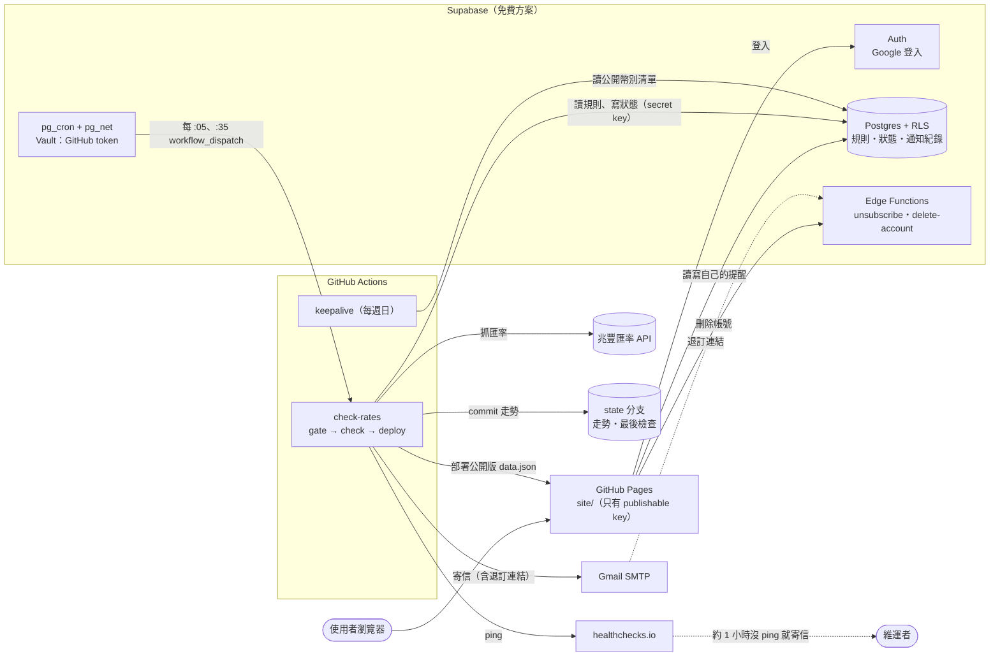

# fx-alert 匯率到價提醒

追蹤兆豐銀行日圓（JPY）、韓元（KRW）的**現金賣出價**。用 Google 登入、設定自己的目標價，
跌到目標時寄 Email 到自己的信箱；同一次到價只通知一次。
全部跑在免費方案上：GitHub Actions、GitHub Pages、Supabase、Gmail、healthchecks.io。

**網站：<https://xysmr.github.io/fx-alert/>**（不登入也能看目前匯率、換匯試算和 30 天走勢）

- [使用者說明](#使用者說明)：登入、設定目標價、取消通知、刪除帳號
- [維運說明](#維運說明)：架構、設定、排程與監控、排查、本機開發

---

# 使用者說明

## 設定提醒

1. 打開網站，按右上角 **用 Google 登入**。
2. 在 **我的提醒** 選擇幣別，輸入 **你的目標**（現金賣出價），按 **儲存**。
   - 例如日圓目標 `0.205`：兆豐的日圓現金賣出價 ≤ 0.205 時寄信給你。
   - 目標價和現價差超過 30% 時，儲存前會再問一次，避免打錯小數點。
3. 平日台灣時間 09:00–16:30，大約每 30 分鐘檢查一次。到價時寄到你登入用的 Gmail。

每個幣別一條提醒。可以隨時修改目標價、取消勾選 **啟用** 暫停某個幣別，或按 **刪除** 拿掉。

## 什麼時候會收到信

| 你的提醒狀態 | 什麼時候 | 結果 |
|---|---|---|
| 等待中 | 現價 ≤ 你的目標 | **寄一封信** → 變成「已通知」 |
| 已通知 | 現價還在目標附近或以下 | 不重複寄 |
| 已通知 | 匯率回升超過「進階設定」裡的門檻 | 回到等待中（不寄信），之後再跌到目標會再通知 |
| 已通知 | 你改了目標價，而且現價高於新目標 | 回到等待中（不寄信），跌到新目標會再通知 |

**進階設定**：展開後會顯示「匯率回升到 X 以上，才會再提醒你」。預設是目標價再加 0.5%，
避免匯率在目標附近來回跳時一直收到信。一般不需要調整。

重新啟用某個提醒、或重新打開 Email 通知時，提醒會重設為「等待中」，不會補寄關閉期間的通知；
如果當下已經低於目標，下一次檢查就會寄信。

## 不想收信、或想刪除帳號

- **暫停所有通知**：取消勾選 **Email 到價通知**，設定會保留，之後可以再打開。
- **一鍵取消**：每封通知信都有「取消通知」連結，點一下就不會再寄（效果同上）。
- **刪除帳號**：在 **帳號** → **刪除我的帳號**，輸入確認文字後刪除。Email、提醒設定、通知紀錄會立刻一起刪除，無法復原。
  為了安全，需要是 10 分鐘內登入的；太久的話請先登出再登入。

## 隱私

只存你的 Email、提醒設定和通知紀錄；每個人只看得到自己的資料。
公開的網頁和程式碼都不會出現你的 Email 或目標價。詳見網站上的[隱私說明](https://xysmr.github.io/fx-alert/privacy.html)。

網站上的匯率僅供參考，實際以兆豐銀行公告為準。

---

# 維運說明

## 架構



### 排程與觸發

| 什麼 | 時間（台灣） | 說明 |
|---|---|---|
| **Supabase pg_cron**（主要） | 平日 09:05–15:35 每 :05、:35，以及 16:05 | `private.dispatch_check_rates()` 經 pg_net 呼叫 GitHub API，觸發 `check-rates`（`source=pg_cron`、`force=false`） |
| GitHub `schedule`（備援） | 平日 09:07–15:37 每 :07、:37，以及 16:07 | GitHub 的排程常延遲或被丟掉，所以只當備援 |
| `check-rates` 的 **gate** | 每次開始時 | 自動觸發且 20 分鐘內已成功檢查過 → 略過（不檢查、不 ping、不部署，仍是綠燈）；手動執行一律檢查 |
| 檢查時段 | 09:00–16:30 | 時段外程式會略過（`config.yaml` 的 `business_hours`） |
| **healthchecks.io** | — | 每次真的檢查成功就 ping；約 1 小時沒收到 → 寄信給維運者 |
| `keepalive` | 每週日 12:23 | 用 publishable key 讀一次公開幣別清單，避免 Supabase 免費專案因閒置暫停 |

pg_cron 的排程寫在 `supabase/migrations/20261110020000_dispatch_check_rates.sql`（UTC：`5,35 1-7 * * 1-5`、`5 8 * * 1-5`）。

### Workflows（`.github/workflows/`）

| Workflow | 觸發 | 做什麼 |
|---|---|---|
| `check-rates` | pg_cron、GitHub schedule、手動 | gate（去重）→ check（抓匯率、判斷、寄信、寫回狀態、commit 走勢、ping 監控）→ deploy |
| `deploy-pages` | push 前端／設定到 main、被 check-rates 呼叫、手動 | 產生 `config.js`、`data.json`（`AUTH_ENABLED=true` 時是不含個人設定的公開版）→ 防外洩檢查 → 部署 |
| `ci` | push、PR | validate-config＋防外洩、ruff、pytest、前端測試、Deno（Edge Functions）、資料庫 RLS 測試（真正的 Supabase） |
| `staging-check` | 手動、staging 的 pg_cron | 用 staging 的 Supabase 跑一次（預設只讀；勾 `send` 才真的寄信） |
| `keepalive` | 每週日、手動 | 讀一次公開幣別清單 |

## 設定一覽

repo 是公開的：**有權限的金鑰只放 Secrets、Edge Function Secrets、Vault**；Variables 只能放公開值（會出現在網頁裡）。

### GitHub Secrets（Settings → Secrets and variables → Actions）

| Secret | 內容 |
|---|---|
| `SUPABASE_URL` | 正式專案網址 `https://<專案代號>.supabase.co` |
| `SUPABASE_SECRET_KEY` | 正式專案給 GitHub 用的 secret key（`sb_secret_…`） |
| `UNSUBSCRIBE_SECRET` | 退訂連結的簽章密鑰（≥ 32 字元），**必須和正式專案 Edge Function 的同名 secret 相同** |
| `SMTP_USER` | 寄件 Gmail 帳號 |
| `SMTP_PASSWORD` | Gmail **應用程式密碼**（帳號需開啟兩步驟驗證） |
| `HEALTHCHECK_PING_URL` | （選用）healthchecks.io 的 ping 網址；等同密碼 |
| `STAGING_SUPABASE_URL`、`STAGING_SUPABASE_SECRET_KEY`、`STAGING_UNSUBSCRIBE_SECRET` | 只給 `staging-check` 用 |

### GitHub Variables（同一頁的 Variables 分頁）

| Variable | 內容 |
|---|---|
| `SUPABASE_URL` | 正式專案網址（前端用） |
| `SUPABASE_PUBLISHABLE_KEY` | `sb_publishable_…`（公開金鑰，安全靠 RLS） |
| `AUTH_ENABLED` | `true`：網站顯示登入、`data.json` 用公開版。刪掉這個 Variable＝回到單人版的網站 |

### Supabase（正式、staging 各自設定）

| 位置 | 名稱 | 內容 |
|---|---|---|
| Edge Functions → Secrets | `UNSUBSCRIBE_SECRET` | 和 GitHub Secret 相同的值（名稱手動輸入，**結尾不能有空白**） |
| Edge Functions → Secrets | `FX_SECRET_KEY` | 給 Edge Function 用的另一把 secret key |
| Integrations → Vault | `github_dispatch_token` | fine-grained PAT：只限 fx-alert、只開 **Actions: Read and write**、90 天到期；正式、staging 各一把 |
| Integrations → Vault | `github_dispatch_workflow` | 正式專案 `check-rates.yml`；staging `staging-check.yml` |
| Authentication → URL Configuration | Site URL、Redirect URLs | 正式專案只有 `https://xysmr.github.io/fx-alert/`（**不放 localhost**，本機開發一律對 staging） |
| Authentication → Providers | Google | Client ID／Secret 來自 Google Cloud 的 OAuth 用戶端；Email 登入關閉 |

Vault 一律在後台頁面新增，**不要**用 SQL Editor 執行 `vault.create_secret(...)`（查詢紀錄會留下 token）。

### 其他

- **GitHub Pages**（Settings → Pages）：Source 選 **GitHub Actions**。
- **healthchecks.io**：見下方〈[監控](#監控healthchecksio)〉。
- `config.yaml`：要追蹤的幣別、檢查時段、每日寄信上限、`state` 分支的資料夾。

### 金鑰到期與輪替

| 金鑰 | 期限 | 輪替方式 |
|---|---|---|
| `github_dispatch_token`（正式、staging 各一把） | 90 天 | 到期前建立新的 PAT → 更新 Vault → 下一個 :05 確認 pg_net 回 204 → 刪除舊的 PAT |
| `SUPABASE_SECRET_KEY`、`FX_SECRET_KEY` | 不會到期 | 建立新 key → 更新 GitHub Secret／Edge Function Secret → 冒煙測試 → 刪除舊 key → 再測一次 |
| `UNSUBSCRIBE_SECRET` | 不會到期 | GitHub、Edge Function 兩邊同時換成同一個新值；舊信的退訂連結會失效 |

token 過期時 pg_net 會回 401：GitHub schedule 仍是備援但常延遲，healthchecks.io 會寄信提醒。

## 資料存放

| 位置 | 內容 | 公開？ |
|---|---|---|
| Supabase `profiles` | 每人的 Email、Email 通知開關 | 否（RLS：只看得到自己） |
| Supabase `alert_rules` | 每人每幣別的目標價、buffer、狀態 | 否 |
| Supabase `notifications` | 通知紀錄 | 否 |
| `state` 分支 `history/YYYY-MM.csv` | 匯率走勢（`quoted_at,currency,cash_sell`） | 是 |
| `state` 分支 `last_check.json` | 最後一次檢查的時間、是否成功、錯誤**數量**（gate 也用它去重） | 是 |
| `state` 分支 `state.json`、`alerts.csv` | 單人版時期的狀態與通知紀錄；多人版不再更新，只在退回單人版時使用 | 是 |
| 網站 `data.json` | 公開行情（不含任何人的目標價、狀態、通知紀錄） | 是 |

commit 到 `state` 分支、部署 `data.json` 前都會自動掃描，確認沒有 Email 或個人設定。

## 排程沒有執行時怎麼排查

GitHub Actions 的 `schedule` 是「盡力而為」：官方文件寫明負載高時（尤其整點、UTC 00:00–08:00）會**延遲**，
負載夠高時排隊中的排程會被**直接丟掉**，而且**不會出現在任何紀錄裡，也不會顯示失敗**。
所以主要的觸發改由 Supabase pg_cron 負責，GitHub schedule 當備援，並用 healthchecks.io 發現「沒有執行」。

### 監控：healthchecks.io

每次**真的檢查成功**後，`check-rates` 會 ping 一次；失敗時 ping `/fail`。
略過時（時段外、gate 去重、`dry_run`）都不 ping，監控才能發現該跑的時段沒有檢查。

1. 到 <https://healthchecks.io> 註冊（免費方案可監控 20 個工作），新增一個 check：
   - **Schedule**：選 **Cron**，填兩行
     ```
     7,37 9-15 * * 1-5
     7 16 * * 1-5
     ```
   - **Time Zone**：`Asia/Taipei`
   - **Grace Time**：`30 minutes`（下一次也沒來，就是約 1 小時沒有 ping → 寄信）
   - **Integrations**：Email
2. 複製 **ping URL**，放到 GitHub Secret `HEALTHCHECK_PING_URL`。⚠ 不要寫進 repo、issue 或截圖。
3. 手動跑一次 `check-rates`，check 應該變成綠色 **up**。沒設定這個 Secret 時只會略過 ping，不會讓排程失敗。

### 收到 DOWN 通知時，照順序檢查

1. **pg_cron 有沒有觸發**：在正式專案的 SQL Editor 執行
   ```sql
   select to_char(d.start_time at time zone 'Asia/Taipei', 'MM-DD HH24:MI') as 時間, d.status, d.return_message
   from cron.job_run_details d join cron.job j using (jobid)
   where j.jobname like 'fx-alert-dispatch%' order by d.start_time desc limit 5;

   select to_char(created at time zone 'Asia/Taipei', 'MM-DD HH24:MI:SS') as 時間,
          status_code, left(coalesce(error_msg, content::text, ''), 200) as 內容
   from net._http_response order by created desc limit 5;   -- 只保留 6 小時
   ```
   | `status_code` | 意思 |
   |---|---|
   | **204** | GitHub 已接受觸發（問題在 GitHub 端，往下看） |
   | 401 | token 錯誤或已過期 → 換新的 PAT（見〈金鑰到期與輪替〉） |
   | 403、404 | token 沒選到 fx-alert，或沒開 Actions 寫入 |
   | 422 | 送出的 inputs 和 workflow 對不上（migration 和 workflow 版本不一致） |
   | 空白＋錯誤訊息 | 網路問題或逾時 |

   `cron.job_run_details` 完全沒有新紀錄：Supabase 專案可能被暫停了（到 Supabase 後台恢復）。
2. **workflow 是不是被停用了**：Actions → `check-rates`，出現「This workflow was disabled」就按 **Enable workflow**。
   公開 repo **60 天沒有任何活動**時，GitHub 會自動停用排程。
3. **有沒有執行紀錄**：Actions → `check-rates`。
   - **紅的**：點進去看哪一步失敗。`gate` 的 **Show trigger** 會印出觸發方式、source、實際開始時間。
     常見原因：`Validate config.yaml` 格式錯誤；兆豐 API 或 Supabase 暫時連不上（下一次通常就好了）；Secrets 被改錯（Supabase 回 401）。
   - **綠的但 check 被略過**：看 gate 的 **Decide**，「N 分鐘前已經成功檢查過，略過這次」是正常的去重。
   - **綠的、有 check，但寫「不在檢查時段內」**：觸發得太晚（例如 GitHub 排程延遲好幾小時），屬於正常略過。
4. **補救**：Actions → `check-rates` → **Run workflow**（`force` 保持勾選、`source` 保持 manual）立刻補跑一次。
5. **確認恢復**：`state` 分支出現新的 `data: … 台灣時間` commit，healthchecks.io 回到 **up**。

## 本機開發

本機開發一律連 **staging**（正式專案不允許 localhost 登入）。

```powershell
python -m venv .venv
.venv\Scripts\Activate.ps1                 # macOS / Linux: source .venv/bin/activate
python -m pip install -e ".[dev]"

python -m pytest                           # Python 測試
python -m ruff check .                     # lint
node --test site/tests/app.test.js site/tests/account.test.js site/tests/unsubscribe.test.js  # 前端測試
# 資料庫測試（tests/db）需要 Supabase CLI + Docker，沒有的話會自動略過、交給 CI 跑

python -m fx_alert validate-config         # 驗證 config.yaml
python -m fx_alert build-site              # 產生 site/data.json

# 前端連 staging：產生指向 staging 的 site/config.js（只用 publishable key）
$env:AUTH_ENABLED = "true"
$env:SUPABASE_URL = "https://<staging 專案代號>.supabase.co"
$env:SUPABASE_PUBLISHABLE_KEY = "sb_publishable_..."
python -m fx_alert site-config --out site\config.js
python -m http.server 8000 -d site         # 開 http://localhost:8000/

# 多人版檢查（只讀不寫）：secret key 只從環境變數讀，不要寫進 .env
# python -m fx_alert check --mode multi --dry-run --force
```

前端也可以用範例資料預覽（範例中的走勢是假資料，用 `python scripts/make_samples.py` 重新產生）：

| 網址參數 | 情境 |
|---|---|
| `?data=samples/waiting.json` | 兩個幣別都在等待中 |
| `?data=samples/triggered.json` | 日圓已低於目標、已寄通知 |
| `?data=samples/rebound.json` | 日圓已通知過，但回升到目標和回升門檻之間 |
| `?data=samples/empty.json` | 還沒有任何資料 |
| `?data=samples/error.json` | 最後一次檢查失敗 |
| 加上 `&now=2026-11-14T12:00` | 把「現在」設成指定的台灣時間（例如週末，看「非檢查時段」的狀態列） |

> Windows 若出現「應用程式控制原則已封鎖此檔案」，把 `pytest`、`ruff` 改成 `python -m pytest`、`python -m ruff`。

### 資料庫變更

migration 放在 `supabase/migrations/`，目前**手動**在 Supabase 的 SQL Editor 套用：先 staging、驗證後再正式專案。
有依賴 workflow 的 migration（例如 pg_cron 送出的 inputs）要**先合併 workflow 的 PR，再套用 migration**。
（之後會改成 GitHub Actions 部署，正式專案需要核准。）

## 退回單人版

步驟見 [`docs/multi-user.md`](docs/multi-user.md) 的「D. 退回方案」：停用排程、刪掉 Variable `AUTH_ENABLED`、
用 `python -m fx_alert export-state` 把資料庫裡的狀態寫回 `state` 分支、revert 切換的 PR。

## 專案結構

```
src/fx_alert/
  fetcher.py      下載兆豐匯率 JSON
  parser.py       解析成 Decimal（缺值 = None）
  rules.py        到價狀態機（純函式）
  store.py        規則與狀態的存放處：SupabaseStore（多人版）／FileStore（單人版）
  gate.py         check-rates 的去重判斷（只用標準函式庫）
  notifier.py     Gmail SMTP / dry-run
  unsubscribe.py  一鍵退訂的 HMAC 簽章與連結
  history.py      走勢、通知紀錄、最後檢查
  config.py       讀取並驗證 config.yaml、檢查時段
  build_site.py   產生前端用的 data.json（--public：多人版的公開版）
  site_config.py  產生 site/config.js（只放 publishable key）
  migrate.py      單人版 → 多人版的搬家工具（migrate-me）
  export_state.py 多人版 → 單人版的反向匯出（export-state，退回用）
  state_store.py  單人版的 state.json
  main.py         CLI：check / build-site / site-config / validate-config / migrate-me / export-state …
site/
  index.html  style.css  app.js     網站（純 HTML/JS，無建置步驟）
  account.js                        Google 登入、我的提醒、刪除帳號（AUTH_ENABLED 開啟時才啟用）
  unsubscribe.html  unsubscribe.js  退訂確認頁
  privacy.html                      隱私說明
  vendor/                           Chart.js、supabase-js
  samples/  tests/                  本機預覽資料、前端測試（不部署）
supabase/
  migrations/                       資料表、RLS、排程用的函式、pg_cron 外部觸發
  functions/unsubscribe/            一鍵退訂 Edge Function（Deno）
  functions/delete-account/         刪除帳號 Edge Function（Deno）
tests/                              Python 測試；tests/db/ 是資料庫（RLS、pg_cron）測試
docs/multi-user.md                  多人版設計、切換與退回流程
```

## 資料來源

[兆豐銀行牌告匯率](https://www.megabank.com.tw/personal-banking/foreign-exchange/exchange-rate/exchange-rate)。
原本規劃使用臺灣銀行，但其牌告匯率網站有機器人驗證，程式無法合規取得，因此改用兆豐銀行
（四家候選銀行中唯一提供韓元現鈔報價者）。網站上的匯率僅供參考，實際以銀行公告為準。
