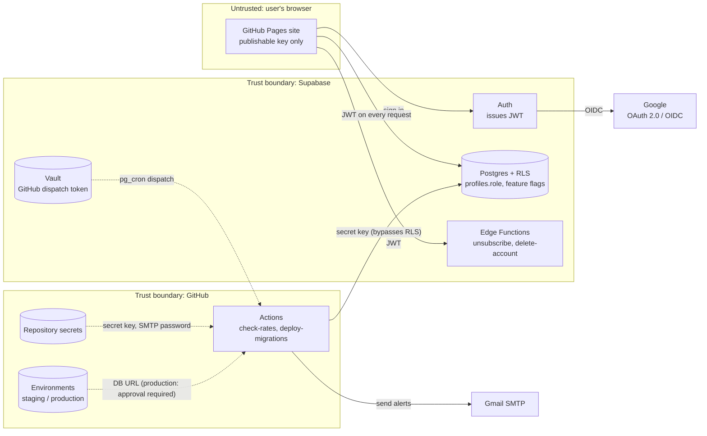

# Security Design – Feature Experiment (DevOps Assignment 10, Task 2)

Owner: Developer (XYSMR). Scope: security for the two features that will be put behind toggles:

| Flag | Feature |
|---|---|
| `trip_plan` | Trip Exchange Plan (`trips`, `trip_exchanges`, `trip_notifications`) |
| `quick_target` | One-click target buttons (−0.5% / −1% / −2%) on each currency card |

## 1. Architecture and trust boundaries



* The browser is untrusted: it only holds the publishable key, so every table relies on RLS.
* Keys that bypass RLS (`sb_secret_…`, database URLs) only exist in GitHub secrets, Supabase Edge Function secrets and Vault.

## 2. Authentication and authorization

| Decision | Choice | Reason |
|---|---|---|
| Login | Supabase Auth + **Google OAuth 2.0 / OIDC**; email login disabled | No passwords to store; users already have Google accounts |
| Session | **JWT** (short-lived access token + refresh token) | Postgres reads `auth.uid()` from the JWT, so RLS works without a backend server |
| Roles | **RBAC**: `profiles.role` = `user` / `beta` / `admin` (migration `20261122000000_user_roles.sql`) | Three roles are enough for a feature experiment; simpler than ABAC |
| Role changes | Only `service_role` | `authenticated` only has column-level `UPDATE` on `email_enabled`, `notify_start`, `notify_end` |
| Feature access | Checked in Postgres (RLS / functions), never only in the UI | A hidden button is not access control |

### Who may use each toggled feature

| | Anonymous | `user` inside rollout % | `user` outside rollout % | `beta` | `admin` |
|---|---|---|---|---|---|
| `trip_plan` | ✗ | ✓ | ✗ | ✓ | ✓ |
| `quick_target` | ✗ | ✓ | ✗ | ✓ | ✓ |
| Change roles / flags | ✗ | ✗ | ✗ | ✗ | `service_role` only |

Planned server-side check once the Operator's `is_feature_on()` exists:

```sql
create policy "trip_plan only when flag is on" on public.trips
  for insert to authenticated
  with check (user_id = (select auth.uid()) and public.is_feature_on('trip_plan'));
```

## 3. Software Composition Analysis (Dependabot)

* `.github/dependabot.yml`: weekly updates for `pip` and `github-actions`.
* Not covered by Dependabot (reviewed manually): `site/vendor/` (supabase-js, Chart.js copied into the repo) and Deno imports in `supabase/functions/`.
* Each alert is recorded as **Upgrade / Replace / Accept** with a reason in the assignment report.

## 4. Secret management

| Secret | Where it lives | Used by |
|---|---|---|
| `SUPABASE_URL`, `SUPABASE_SECRET_KEY`, `UNSUBSCRIBE_SECRET`, `SMTP_USER`, `SMTP_PASSWORD`, `HEALTHCHECK_PING_URL` | Environment `production-runtime` (`main` only, no reviewer) | `check-rates` (scheduled) |
| `STAGING_SUPABASE_*`, `STAGING_UNSUBSCRIBE_SECRET`, `SMTP_*` | Environment `staging-runtime` (`main` only) | `staging-check` |
| `STAGING_DB_URL` | Environment `staging` | `deploy-migrations` (staging job) |
| `PRODUCTION_DB_URL` | Environment `production` (required reviewer, `main` only) | `deploy-migrations` (production job) |
| `UNSUBSCRIBE_SECRET`, `FX_SECRET_KEY` | Supabase Edge Function secrets | Edge Functions |
| `github_dispatch_token` | Supabase Vault | `pg_cron` → workflow dispatch |
| Publishable key, project URL | GitHub Variables (public by design) | Website |

Repository-level secrets: none.

Controls: secret scanning and push protection are enabled; CI fails if public files contain an email address, `SMTP_` or `sb_secret_`; secrets are passed only to the steps that need them and never printed; a test checks that every job using secrets is bound to an environment (`tests/test_workflows.py`).

### Risk found: teammates and repository secrets

Collaborators on a **personal** repository always get **Write** access (the Triage role exists only in organizations). With Write, anyone can push a branch with a modified workflow, and that workflow can read **repository** secrets.

* **Accepted for now:** teammates need to push branches (for example `feat/feature-flags`), and they are trusted classmates. No pushed branch changes `.github/workflows/`.
* **Mitigated now:** the ruleset on `main` requires a pull request with 1 approval (the repository admin can bypass for their own changes) and all CI checks, so a modified workflow cannot reach `main` without review; `production` only deploys from `main`.
* **Planned (PR #47):** move every secret into environments limited to `main` (`production-runtime`, `staging-runtime`), then rotate the production secret key and the Gmail app password.

## 5. Built now vs planned

| Item | Status |
|---|---|
| Google OIDC login, JWT sessions | Built |
| RLS on every public table | Built |
| Environments `staging` / `production` with approval | Built |
| Secret scanning, push protection, CI secret check | Built |
| `profiles.role` + `current_user_role()` + tests | Built (this PR) |
| Dependabot config | Built (this PR) |
| Dependabot alerts / security updates, CodeQL, private vulnerability reporting, `SECURITY.md` | Built |
| Ruleset on `main` (PR + 1 approval + 6 checks) | Built |
| RLS on `trips` gated by `trip_plan` flag | Planned (after the Operator's flag table) |
| All secrets in branch-limited environments | Built |
